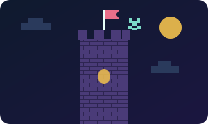

# 

I'm a software engineer with commercial experience across full-stack, front-end and mobile, and mobile is what I love most. I specialise in React Native, Expo and TypeScript, building and maintaining production apps on iOS and Android as part of cross-functional Agile teams. I care a lot about accessibility and about building apps that feel great to use. 📱

## ✨ Right now

- 💼 **Building** mobile apps full-time.
- 🌟 **Freelancing** with a small business: understanding their challenges, building them an app and cutting their monthly costs
- 📊 **Side project** with a former colleague: a data-focused SaaS dashboard in Laravel and Filament, exploring how AI can help businesses monitor and dig into data issues
- 🌱 **Learning** Performance enhancements + Godot
- ⚡ **Fun fact** I make little pixel games in Godot after work 🕹️

## 🛠️ What I work with

| Area                   | Tools                                                                             |
| ---------------------- | --------------------------------------------------------------------------------- |
| 📱 **Mobile**          | React Native · Expo · Expo Router · Reanimated · NativeWind · Redux Toolkit · EAS |
| 🌐 **Front-end**       | TypeScript · JavaScript · React · Next.js · HTML · CSS / SCSS · Tailwind          |
| 🐘 **Backend**         | PHP · Laravel · Filament · Statamic · AWS · Laravel Cloud                         |
| 🧪 **Testing**         | Jest · Playwright · Maestro · Pest · PHPUnit · BrowserStack                       |
| ♿ **Accessibility**   | WCAG · accessibility auditing · QA                                                |
| 🤝 **Ways of working** | Agile / Scrum · GitHub · Bitbucket · AI-assisted development                      |

## 🕹️ After hours

I make little pixel games in Godot just for fun!

## 📫 Find me

[https://www.linkedin.com/in/millie-williamson-138511253/](https://www.linkedin.com/in/millie-williamson-138511253/)

